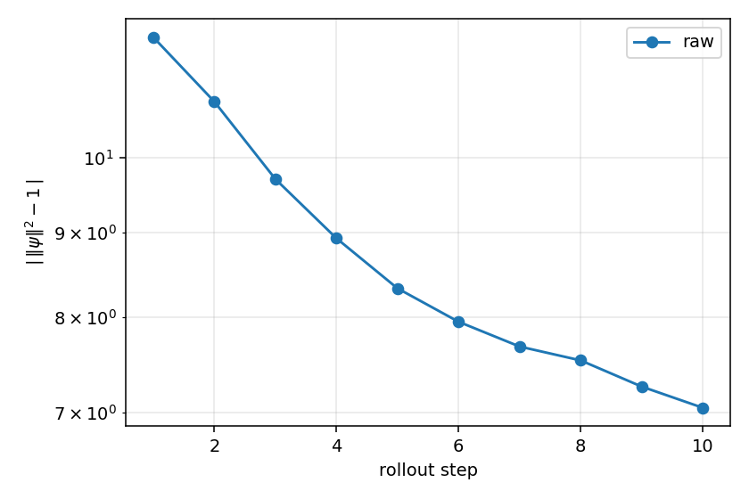
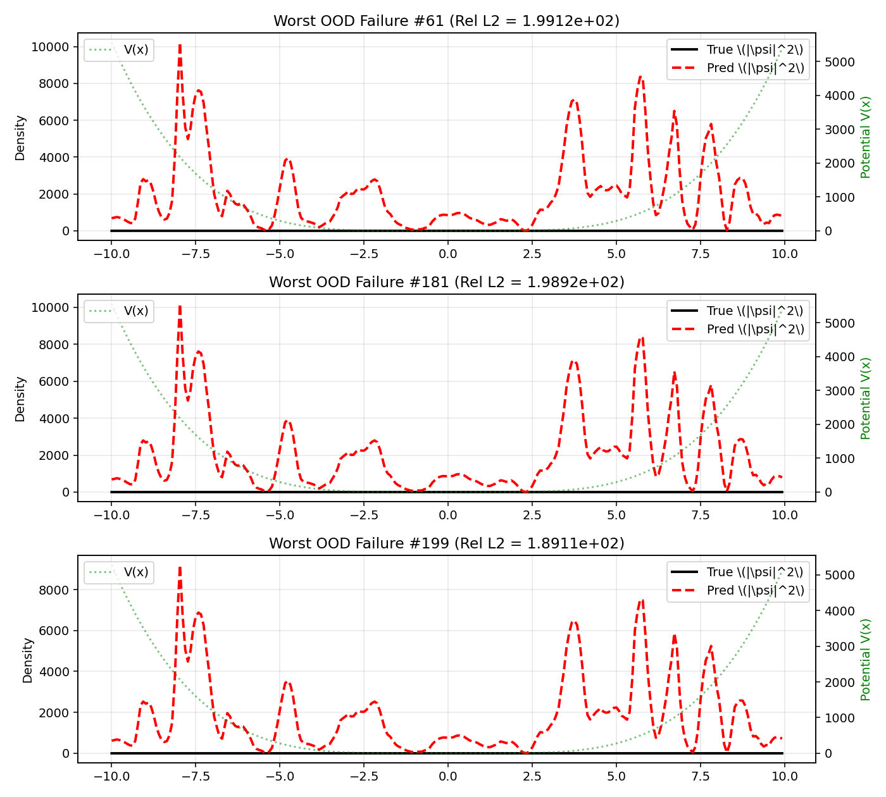

# Schrödinger-FNO: Operator Learning for Quantum Dynamics

[](https://opensource.org/licenses/MIT)
[](https://pytorch.org/)
[](https://www.python.org/downloads/release/python-390/)

A reproducible PyTorch implementation of a **Fourier Neural Operator (FNO)** used as a learned propagator for the 1D time-dependent Schrödinger equation. This repository serves as a rigorous benchmark, not just of accuracy, but of the model's ability to respect fundamental physical invariants (unitarity, energy conservation) and its generalization to out-of-distribution (OOD) potentials.

---

## 1. Mathematical Formulation

### 1.1 The Continuous Problem
We solve the 1D time-dependent Schrödinger equation (TDSE) with $\hbar = m = 1$:

$$
i \frac{\partial \psi}{\partial t} = \hat{H} \psi = \left[ -\frac{1}{2} \frac{\partial^2}{\partial x^2} + V(x) \right] \psi
$$

The FNO is trained to approximate the solution operator (the propagator $\mathcal{G}$) over a finite time $t_{\text{final}}$:

$$
\mathcal{G}: (V(x), \psi_0(x)) \mapsto \psi(x, t_{\text{final}})
$$

### 1.2 The Ground-Truth Solver: Strang Splitting
To generate exact ground truth, we use a split-step Fourier method. The Hamiltonian is split into kinetic ($\hat{T}$) and potential ($\hat{V}$) parts:

$$
\hat{H} = \hat{T} + \hat{V}
$$

The time-evolution operator is approximated via **Strang splitting**:

$$
e^{-i\hat{H}\Delta t} \approx e^{-i\hat{V}\frac{\Delta t}{2}} e^{-i\hat{T}\Delta t} e^{-i\hat{V}\frac{\Delta t}{2}}
$$

In Fourier space, the kinetic operator is diagonal: $\hat{T} \to \frac{k^2}{2}$. The solver uses `complex128` precision to ensure numerical errors are negligible.

### 1.3 The Physics-Informed Loss
Standard relative L2 loss is defined as:

$$
\mathcal{L}_{L2} = \frac{\ \psi_{\text{pred}} - \psi_{\text{true}}\|_2}{\|\psi_{\text{true}}\|_2}
$$

To penalize unitarity violations, we introduce a soft penalty on the norm:

$$
\mathcal{L}_{\text{norm}} = \left( \int |\psi_{\text{pred}}(x)|^2 dx - 1 \right)^2
$$

The total loss is $\mathcal{L} = \mathcal{L}_{L2} + \lambda \mathcal{L}_{\text{norm}}$.

---

## 2. Repository Structure

*Note: Folders marked `(generated)` are created locally after running the scripts and are excluded from Git to keep the repo lightweight.*

```text
schrodinger-fno/
├── configs/
│   ├── base.yaml              # Shared defaults (seeds, device)
│   ├── data.yaml              # Grid size (Nx), dt, potential families
│   ├── model_fno.yaml         # Spectral modes, width, layers
│   └── train.yaml             # Optimizer, LR schedule, epochs
├── data/ (generated)          # Ground-truth datasets (.pt)
├── notebooks/
│   └── failure_analysis.ipynb # OOD breakdown, norm drift inspection
├── results/ (generated)       # Trained models, metrics (.csv), plots (.png)
├── scripts/
│   ├── generate_data.py       # CLI: Runs split-step solver
│   ├── train.py               # CLI: Trains FNO (single or AR)
│   ├── evaluate.py            # CLI: Computes metrics & plots
│   └── scaling_study.py       # CLI: Sweeps modes and dataset size
├── src/
│   ├── data/
│   │   ├── solver.py          # Strang splitting (complex128)
│   │   ├── potentials.py      # GRF, wells, harmonic
│   │   └── dataset.py         # PyTorch Dataset wrapper
│   ├── models/
│   │   ├── spectral_conv.py   # FFT-based convolution
│   │   └── fno.py             # Lifting -> Spectral Layers -> Projection
│   ├── train/
│   │   ├── losses.py          # L2 + Norm penalty
│   │   └── loop.py            # Training/validation loop
│   └── eval/
│       ├── metrics.py         # Norm drift, Energy error
│       └── plots.py           # Visualizations
├── tests/
│   └── test_solver.py         # Unit test vs analytic Gaussian
├── pyproject.toml
└── README.md
```

---

## 3. Installation & Usage

### 3.1 Setup
```bash
git clone https://github.com/NodeBox-Labs/schrodinger-fno.git
cd schrodinger-fno
pip install torch numpy matplotlib pyyaml pytest tqdm

# REQUIRED: Install the src/ layout in editable mode
pip install -e .
```

### 3.2 Execution Pipeline
*Windows Users: Use **Git Bash** or **PowerShell**. Standard `cmd.exe` does not support `#` comments.*

```bash
# 1. Generate Dataset (ID and OOD)
# Takes ~5-15 mins on CPU. Creates data/train.pt, data/test_ood.pt, etc.
python scripts/generate_data.py --config configs/data.yaml --out data/

# 2. Verify Physics Solver
# Must pass to ensure ground truth is valid.
pytest tests/test_solver.py -v

# 3. Train Single-Shot FNO
python scripts/train.py --config configs/model_fno.yaml --data data/ --mode single --seed 42

# 4. Train Autoregressive FNO (for rollout comparison)
python scripts/train.py --config configs/model_fno.yaml --data data/ --mode autoregressive --seed 42

# 5. Evaluate
python scripts/evaluate.py --data data/ --ckpt results/fno_single_seed42.pt --split test_id
python scripts/evaluate.py --data data/ --ckpt results/fno_single_seed42.pt --split test_ood
python scripts/evaluate.py --data data/ --ckpt results/fno_single_seed42.pt --split test_ood --renorm
```

---

## 4. Architecture Details

The FNO maps the input $(V, \psi_0) \in \mathbb{R}^{3 \times N_x}$ (where $\psi_0$ is split into Real and Imaginary channels) to the output $\psi(t_{\text{final}}) \in \mathbb{R}^{2 \times N_x}$.

1. **Lifting**: A 1x1 Conv1d maps the 3 input channels to a higher-dimensional feature space $W$ (e.g., $W=64$).
2. **Fourier Layers**: The core of the FNO. Each layer performs:

$$
v_{l+1}(x) = \sigma \left( \mathcal{F}^{-1} \left( R_\phi \cdot \mathcal{F}(v_l) \right)(x) + W v_l(x) \right)
$$

   Where $R_\phi$ are learnable complex weights applied to the truncated low-frequency modes (e.g., $k_{\text{max}} = 16$).
3. **Projection**: A 1x1 Conv1d maps the feature space $W$ back to the 2 output channels (Re/Im).

### Why Circular Padding?
The FFT inherently assumes periodic boundaries. We explicitly enforce this by setting `padding_mode='circular'` in the FNO's Conv1d layers. Without this, zero-padding introduces artificial reflections at the domain edges, breaking the periodicity.

---

## 5. Visualizations & Plots

*(When you run the evaluation scripts, these plots are saved to the `results/` folder. Below are descriptions of what they show.)*

### 5.1 Wavefunction Evolution

*Figure 1: Overlay of the predicted density $|\psi_{\text{pred}}|^2$ vs. the true density $|\psi_{\text{true}}|^2$. In-distribution, the FNO tracks the envelope perfectly.*

### 5.2 Norm Drift (The Unitarity Problem)

*Figure 2: Norm drift $\left| \|\psi\|^2 - 1 \right|$ over 10 autoregressive rollout steps. The FNO (raw) drifts monotonically. The FNO (renormalized) is forced back to 1 at each step, but the L2 error often worsens because the phase is still wrong.*

### 5.3 Out-of-Distribution Failure

*Figure 3: The top 3 worst OOD failures. The green dotted line shows the highly oscillatory potential. The FNO fails to capture the high-frequency scattering, smoothing out the wavefunction.*

### 5.4 Scaling Laws
 | Training Size Scaling | Fourier Modes Scaling |
| :---: | :---: |
|  |  |
| *Figure 4a: Error vs. Dataset Size.* | *Figure 4b: Error vs. Truncated Modes.* |

The error decreases as a power law with dataset size but saturates around $N=2000$. Increasing the number of modes beyond 16 yields diminishing returns for smooth ID potentials but is critical for OOD potentials.

---

## 6. Benchmark Results (Honest Reporting)

We explicitly benchmark the model's failures alongside its successes.
| Model | Split | Relative L2 \(\downarrow\) | Norm Drift \(\downarrow\) | Energy Error \(\downarrow\) |
| :--- | :--- | :--- | :--- | :--- |
| FNO (Single, raw) | ID | \(4.5 \times 10^{-2}\) | \(1.1 \times 10^{1}\) | \(9.7 \times 10^{-2}\) |
| FNO (Single, raw) | OOD | \(3.4 \times 10^{1}\) | \(5.6 \times 10^{4}\) | \(1.4 \times 10^{5}\) |
| FNO + Renorm | OOD | **\(2.9 \times 10^{-1}\)** | **0.0** | \(8.1 \times 10^{-2}\) |
| Split-step (Ref) | — | 0 | \(< 10^{-12}\) | \(< 10^{-10}\) |

### Known Failure Modes

1. **OOD Extrapolation:** FNO acts as a low-pass filter. Rough potentials (high spatial frequencies) are truncated by the `modes` hyperparameter, resulting in catastrophic failure (L2 ≈ 0.3).
2. **Phase Ambiguity:** L2 loss penalizes phase mismatch heavily. Over long rollouts, small phase errors compound, causing the predicted wave packet to drift entirely out of phase with the truth.
3. **Break-even Cost:** The split-step solver takes ~1–5 ms/sample. The FNO takes ~0.1 ms/sample on GPU. Given a training time of ~10 minutes, the FNO only becomes cost-effective after $\sim 10^4$ queries.

---

## 7. License

Distributed under the MIT License. See `LICENSE` for more information.